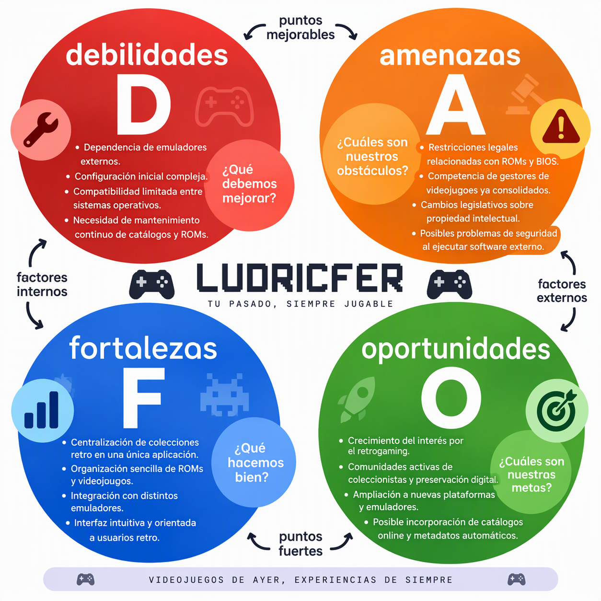

# Ludricfer-BOX
 

# Miembros :
:arrow_right: Richard Christopher Arteaga Martínez
:arrow_right: Luis Fernando Hernandez Jaramillo
 

# Introducción: :memo:

LUDRICFER es una aplicación de gestión de videojuegos retro diseñada para ayudar a los usuarios a organizar sus colecciones, administrar ROMs y ejecutar juegos mediante emuladores externos desde una única plataforma. 
El proyecto busca simplificar la gestión de bibliotecas retro y mejorar la experiencia de los aficionados al retrogaming.
 

